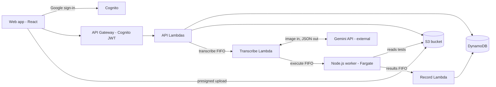

# Paper DSA Exam Judge — System Design (MVP)

Last updated: Oct 17, 2026

## Overview

Students write weekly DSA exams on A4 paper; batch managers photograph each answer; Gemini transcribes it; a worker runs the code against fixed test cases; marks are (tests passed ÷ total tests) × question marks, zero if the solution misses the faculty's time-complexity target.

| Item | Decision |
| --- | --- |
| Users | One college, internal tool, up to 1,500 students in batches |
| Exam rhythm | Weekly, written in class, no devices; one exam per batch |
| Paper | Exam PDF from the app, printed or projected; one question per answer page |
| Languages | Python, C++, Java, Go; anything else is "failed to grade" |
| Clients | Web only, React |
| Sign-in | Google sign-in, college email domain only |
| Retention | Images and scores kept indefinitely for the MVP |
| Team | 2 developers, no latency target, no budget ceiling |

**Key design decision.** Gemini generates each question's test cases once, when the faculty creates the question, and the faculty approves them. The worker then actually compiles and runs every student's code against that same set. Pass or fail on every test comes from real execution, so two students with identical code always get identical test results. Gemini's only grading judgment is the time-complexity check.

**Out of scope for the MVP:** analytics, rank lists, CSV export, plagiarism checks, human review before results, dead-letter queues, live progress, faculty-written test cases.

## Roles and permissions

Four roles, each checked on every API call; a user's role comes from the `Users` table, never from the client.

| Role | Created by | Can do |
| --- | --- | --- |
| Super admin (founders) | Seeded at deploy | Everything below; create teacher and batch-manager accounts; assign batch managers to batches; override any score (every override written to the audit log); every request a super admin makes that changes data, and their reads of results and answers, is also written to the audit log |
| Teacher | Super admin | Assigned to batches by a super admin; create and edit questions; review and approve generated test cases; create one exam per batch with per-question marks; generate the exam PDF; see each student's scores by name; review appeals and re-run grading |
| Batch manager | Super admin | Assigned to one or more batches; upload the student CSV; upload one cropped photo per student per question; mark a student absent; publish results; review appeals and re-run grading |
| Student | Batch manager (CSV) | After publish: see own marks per question and which test cases failed; raise an appeal on a question |

The super admin role is a normal, visible role in the system. Score overrides record who, when, old score, new score and a reason, and a student's result shows that an override was applied.

A batch manager or teacher can only act on batches they are assigned to or own. A student can only read their own results, and only after the exam is published.

## Architecture

A React web app calls Lambdas through API Gateway; grading runs as a chain of three SQS FIFO queues between a Transcribe Lambda (calling Gemini), a Node.js worker on Fargate that actually runs the code, and a Record Lambda that writes scores.

The Node.js worker is the only place pass or fail is decided. Image bytes go from the browser straight to S3 with a presigned URL; the Transcribe Lambda also reads that photo and updates answer status in DynamoDB.

| Component | Choice | Notes |
| --- | --- | --- |
| Frontend | React single-page app hosted on Vercel | Separate screens per role; crop and compress before upload |
| Sign-in | Cognito user pool, Google identity provider | Pre-sign-up check on college domain (or a founder address from the `superAdminEmails` setting) and `Users` table |
| API | API Gateway HTTP API + Lambda, TypeScript on Node.js 22 | Types shared with the React app |
| Queues | SQS FIFO × 3: transcribe, execute, results | Content-based IDs off; dedup ID includes attempt |
| AI | Gemini API from Lambda, structured JSON output | API key in Secrets Manager; temperature 0 |
| Execution | Node.js 22 service in JavaScript, ECS Fargate, 1 task, public subnet with a public IP, scales to zero | Also runs reference solutions during question setup |
| Storage | DynamoDB (on-demand) + one S3 bucket | No other database |
| Exam PDF | Lambda with a PDF library (e.g. PDFKit) | Stored in S3, downloaded through a presigned link |
| Monitoring | CloudWatch logs and two alarms | Oldest-message age on each queue; count of `FAILED_TO_GRADE` per hour |

**Changed from the sketch:** EC2 is now ECS Fargate; EventBridge is dropped; test-case JSON lives per question, not next to each image; a results queue sits between the worker and the Record Lambda as before.

## Question setup and exam PDF

Test cases are made once per question and approved by the teacher before any exam can use it, so every student is graded on the same set.

1. **Teacher writes the question:** title, statement, input/output description, constraints, 1–3 examples, target time complexity (e.g. O(n log n)), time limit, memory limit, and output comparison mode (exact, any order, or float within 1e-6).
2. **Generate tests (async):** a Lambda sends the question to Gemini and gets back structured JSON:
   - a function signature (name, parameters, return type) that students are told to use;
   - a reference solution in Python;
   - 7 small test inputs covering edge cases (10 tests per question in total);
   - a short Python generator script for 3 large inputs, sized so a solution slower than the target complexity exceeds the time limit.
3. **Compute expected outputs by running code, not by asking Gemini:** the worker runs the generator to produce the large inputs, then runs the reference solution on every input. Its outputs become the expected outputs. If the reference crashes or times out on an input, Gemini regenerates that input, so every question keeps exactly 10 tests.
4. **Teacher reviews:** the app shows the signature and a sample of inputs and expected outputs. The teacher approves, edits the examples, or regenerates. Only `APPROVED` questions can go into an exam.
5. **Teacher creates the exam:** picks a batch, picks approved questions in order, and sets marks per question.
6. **Generate the PDF:** a Lambda renders title, batch, date, each question with its number, marks, statement, constraints, examples, the function signature to use, and the allowed languages. Saved to S3; the teacher downloads it to print or project.

Input/output convention: every test input is one JSON object keyed by the signature's parameter names, and every program (reference or student driver) prints its result as one line of JSON.

The worker compares parsed JSON values, so formatting differences between languages (spacing, 2 vs 2.0) never fail a test.

Question test status: `GENERATING` → `NEEDS_REVIEW` → `APPROVED` (or `GENERATION_FAILED`, which the teacher retries).

Once an exam using a question has any graded answers, that question's test cases are frozen; edits create a new question version.

## Grading pipeline

Each answer page moves through three queued stages (transcribe, execute, record) and ends as `GRADED` or `FAILED_TO_GRADE`; no stage ever throws a message back to the queue.

1. **Upload (batch manager app).** Pick batch → exam → student (search by roll number, name or email) → question number → take or choose a photo → crop in the browser. The app compresses the crop to JPEG, long edge about 2,000 px.
2. **Submit.** The app calls `POST /answers/upload-url` through API Gateway and gets a presigned S3 URL, then uploads the image straight to S3. It then calls `POST /answers/submit`. That Lambda increments the answer's `attempt`, sets status `QUEUED`, and sends a message to the **transcribe** FIFO queue.
   - Image bytes skip API Gateway because a Lambda request body is capped at 6 MB, and base64 adds a third. The API call still goes through API Gateway and its auth check.
   - FIFO settings: `MessageGroupId` = exam + student; `MessageDeduplicationId` = exam + student + question + attempt.
3. **Transcribe (Lambda + Gemini).** Sends the image plus the question and its signature to Gemini and asks for structured JSON (rules below). Rejects the result if the page is unreadable or the language is not Python, C++, Java or Go. Saves the transcription and sends the answer to the **execute** FIFO queue.
4. **Execute (Node.js worker on Fargate).** Builds the program from the driver and the student's corrected code, compiles it, runs every test case with the question's limits, compares outputs, and sends per-test verdicts to the **results** FIFO queue.
5. **Record (Lambda).** Writes the verdicts only if the message's `attempt` equals the answer's current `attempt` (a DynamoDB conditional write), so an old run can never overwrite a newer one. Computes the question score and the student's exam total.
6. **Publish.** Nothing is visible to students until a batch manager presses Publish for the exam. Re-runs after publishing update scores in place.

**Gemini transcription rules** (in the prompt, enforced by a JSON schema):

- Transcribe exactly what is written; ignore struck-out text; where text is overwritten, use the final version.
- Restore indentation and fix syntax only: semicolons, brackets, colons, misspelled keywords, OCR misreads (`l`/`1`, `O`/`0`).
- Never change logic: conditions, loop bounds, operators, variable use, return values, algorithm. If code cannot be made valid without a logic change, leave it; it will fail to compile and score 0.
- Return `readable`, `language`, `rawTranscription`, `correctedCode`, a list of every fix made, the estimated time complexity, whether it meets the faculty's target, and a `driverCode` in the same language that reads one test input as JSON from stdin, calls the student's function by whatever name they used, and prints the result as JSON.

**Answer status:** `QUEUED` → `TRANSCRIBING` → `RUNNING` → `GRADED`, or `FAILED_TO_GRADE` with a reason (unreadable, unsupported language, Gemini error, worker error). The batch manager's upload screen shows each answer's status on refresh.

**Errors without dead-letter queues.** Every stage catches all errors, marks the answer `FAILED_TO_GRADE` with the reason, and deletes the message. Without that, a FIFO queue with no DLQ retries a bad message forever, re-calling Gemini each time and blocking that student's other answers. A failed answer is fixed by re-running it (batch manager or teacher).

## Code execution worker

One long-running Node.js service, written in JavaScript, on ECS Fargate (one task) pulls from the execute queue and runs at most one job per vCPU at a time, each as a child process; it also runs the reference solutions during question setup. Node's `child_process.spawn` can start a process as another user (`uid`, `gid`) and kill its whole process group (`detached`), which covers the isolation below; resource limits are set by wrapping each run in the `prlimit` command, since Node can't set them directly.

**Runtimes (pinned, one version each):** Python 3.12, C++17 with g++ `-O2`, Java 21, Go 1.23. Students don't choose versions; the exam PDF states them.

**Per answer:**

1. Create a fresh working directory; write the driver and the student's corrected code into one program.
2. **Integrity check:** the corrected code must appear unchanged inside the assembled program. If Gemini's driver altered it, mark `FAILED_TO_GRADE` (driver mismatch).
3. Compile with a 20-second limit. A compile error fails every test (verdict `CE`).
4. Run each test: input on stdin, output captured up to 1 MB. Time limit = the question's limit × a language factor (C++ and Go 1×, Java 2×, Python 3×). Memory is watched by peak resident memory and the process is killed past the limit.
5. Compare with the expected output using the question's mode (exact after trimming trailing whitespace, any order, or float within 1e-6).
6. Verdict per test: `AC`, `WA`, `TLE`, `MLE`, `RE` or `CE`. Send all verdicts to the results queue and delete the working directory.

**Isolation.** Fargate can't run Docker inside a container or grant extra Linux privileges, so student code is contained per process:

- runs as a dedicated non-root user per worker slot, never as the worker's user;
- process limits stop fork bombs; file-size limits stop disk filling; a wall-clock timeout kills the whole process group;
- container root filesystem is read-only; only the per-run working directory is writable, and it is deleted after;
- the child process gets an empty environment, so it can't find the task's AWS credentials;
- the task sits in a public subnet with a public IP and reaches AWS over the internet; its security group allows no inbound traffic and all outbound, so **student code can reach the internet** (see below);
- the task's IAM role can only read and delete from the execute queue, send to the results queue, read test files in S3, and write test files only under the questions prefix during setup. It has no DynamoDB access, so student code can't touch scores even if it escaped.

**Why the task has internet access.** Private subnets would need a NAT gateway or five VPC endpoints (SQS, CloudWatch Logs, ECR API, ECR Docker, S3), and those cost money every hour even while the worker is scaled to zero. Accepted for the MVP: the code is handwritten on paper and transcribed, so a student is unlikely to write network code that survives that, and the other isolation layers above are unchanged. What internet access adds is a way out for a program that does misbehave, including to anything reachable with the task role's permissions (queues and question tests); that role still has no DynamoDB access. If this stops being acceptable, put the task back in a private subnet with a NAT gateway or endpoints.

If you later want stronger isolation (each run in its own container with networking off), move the worker to ECS on EC2, where the worker can start containers.

**Worker crash mid-job:** the message becomes visible again after the 10-minute visibility timeout and is run again. The attempt check in the record stage prevents a double write.

## Data model

Eight DynamoDB tables (one per entity, simpler for two people than single-table design) and one versioned S3 bucket; a user's college email is their ID everywhere.

| Table | Key (partition / sort) | Main fields | Index |
| --- | --- | --- | --- |
| Users | email | role, name, rollNo, batchId (students), batchIds (batch managers, teachers), active | byBatch: batchId; byRoll: rollNo |
| Batches | batchId | name | — |
| Questions | questionId / version | teacherEmail, title, statement, constraints, examples, signature, targetComplexity, timeLimitMs, memoryMb, compareMode, testStatus, testCount, testsKey | byTeacher: teacherEmail |
| Exams | examId | batchId, title, date, questions [number, questionId, version, marks], status (DRAFT, READY, PUBLISHED), pdfKey, publishedBy, publishedAt | byBatch: batchId |
| ExamStudents | examId / studentEmail | absent, totalScore, maxScore | byStudent: studentEmail |
| Answers | examId#studentEmail / questionNumber | imageKey, attempt, status, failReason, language, rawTranscription, correctedCode, fixes, estimatedComplexity, meetsComplexity, testsPassed, testsTotal, verdicts, score, override | — |
| Appeals | appealId | examId, studentEmail, questionNumber, message, status (OPEN, RERUN, CLOSED), handledBy, note | byExam: examId + status |
| AuditLog | entityKey / timestamp | actor, action, before, after, reason; for super admin requests also method, path, targetIds, statusCode, outcome | byActor: actor |

- `verdicts` holds one verdict per test. For small failed tests it also keeps the input, expected output and student output, each cut to 200 characters; large tests keep only the verdict. This stays well under DynamoDB's 400 KB item limit.
- Displayed score = `override.score` if an override exists, otherwise `score`.
- Score formula: `(testsPassed ÷ testsTotal) × marks`, or 0 when `meetsComplexity` is false or the status is `FAILED_TO_GRADE`. Scores are rounded to 2 decimal places. Absent students score 0 on every question and show "Absent".

**S3 layout** (one bucket, versioning on, no public access):

| Path | Contents |
| --- | --- |
| `answers/{examId}/{rollNo}/q{n}.jpg` | Cropped answer photo; a replacement keeps the old one as a previous version |
| `questions/{questionId}/v{version}/tests.json` | All 10 test inputs and expected outputs |
| `questions/{questionId}/v{version}/reference.py`, `generator.py` | Gemini's reference solution and large-input generator |
| `exams/{examId}/paper.pdf` | The exam PDF |

This replaces the earlier plan of storing a test-case JSON next to each image: tests now live once per question version.

## APIs

All endpoints sit behind API Gateway with a Cognito JWT authorizer; each Lambda then loads the caller's role and batch assignments from `Users` and rejects anything outside them.

**Sign-in:** Cognito user pool with Google as the identity provider. A pre-sign-up Lambda rejects any email that is neither on the college domain nor one of the founders' addresses (`superAdminEmails` in `infra/cdk.json`), and any email not already in `Users`, so only pre-registered people can log in. Founder accounts are plain super admin users: separate from student accounts, never importable as students, with no extra restrictions.

| Method and path | Who | Does |
| --- | --- | --- |
| `GET /me` | All | Current user, role, batches |
| `POST /staff` | Super admin | Create a teacher or batch manager |
| `PUT /staff/{email}/batches` | Super admin | Assign a teacher or batch manager to batches |
| `POST /batches` | Super admin | Create a batch |
| `PUT /answers/{examId}/{studentEmail}/{q}/override` | Super admin | Set or clear an override score with a reason (audited) |
| `POST /batches/{batchId}/students/import` | Batch manager | Upload the CSV (name, college email, roll number, batch); returns created, updated and rejected rows |
| `GET /batches/{batchId}/students?search=` | Batch manager, teacher | Find students by roll number, name or email |
| `POST /answers/upload-url` | Batch manager | Presigned S3 upload URL for one question's photo |
| `POST /answers/submit` | Batch manager | Start grading for one uploaded photo |
| `PUT /exams/{examId}/students/{email}/absent` | Batch manager | Mark or unmark a student absent |
| `GET /exams/{examId}/answers` | Batch manager, teacher | Status of every answer in the exam |
| `POST /exams/{examId}/publish` | Batch manager | Make results visible to students |
| `POST /questions` · `PUT /questions/{id}` | Teacher | Create or edit a question |
| `POST /questions/{id}/generate-tests` | Teacher | Start (or redo) test generation |
| `GET /questions/{id}/tests` | Teacher | Signature and sample inputs and outputs for review |
| `POST /questions/{id}/approve` | Teacher | Approve the test set |
| `POST /exams` · `PUT /exams/{id}` | Teacher | Create or edit an exam for one batch, with marks per question |
| `POST /exams/{id}/pdf` · `GET /exams/{id}/pdf` | Teacher | Generate the PDF; get a download link |
| `GET /exams/{id}/results` | Teacher | Every student's per-question and total scores, by name |
| `GET /answers/{examId}/{studentEmail}/{q}` | Batch manager, teacher | Image link, raw and corrected transcription, fixes, verdicts |
| `POST /answers/{examId}/{studentEmail}/{q}/rerun` | Batch manager, teacher | Re-run grading; new score replaces old |
| `GET /appeals?examId=&status=` · `PUT /appeals/{id}` | Batch manager, teacher | List appeals; close one with a note |
| `GET /me/exams` · `GET /me/exams/{examId}` | Student | Published exams; marks per question and failed tests |
| `POST /appeals` | Student | Appeal one question with a message |

Super admins can call every endpoint above.

## Results, appeals, overrides and absences

Students see nothing until a batch manager publishes the exam; after that, appeals and re-runs change scores in place.

**Publishing.** The batch manager's status board lists every answer. Pressing Publish warns if any answer is still `QUEUED`, `TRANSCRIBING` or `RUNNING`, but doesn't block it.

**What a student sees per question:**

- marks scored out of marks available, and tests passed out of total;
- each failed small test with its input, expected output and their output (cut to 200 characters);
- each failed large test as "Large test N: time limit exceeded" (or its verdict);
- "Did not meet the required time complexity, O(…)" when that rule zeroed the question;
- "Could not be graded — raise an appeal" for `FAILED_TO_GRADE`;
- "Absent" across the exam if marked absent.

**Appeals.**

1. The student appeals one question with a short message. One open appeal per question at a time.
2. A batch manager or teacher opens it and sees the photo, raw transcription, corrected code with the list of fixes, and the verdicts.
3. They either re-upload a better crop and re-run, re-run as is, or close it with a note. A re-run's new score replaces the old one.
4. The student sees the appeal status and the reviewer's note.

**Overrides.** Only super admins can override a score, with a required reason. The audit log keeps the actor, time, old and new score, and reason; the student's view shows "Score adjusted by admin". An override stays in place through re-runs until a super admin clears it. An override can't be set on a student marked absent; unmark absent first.

**Super admin audit.** The API wrapper that every route goes through writes an audit entry for each request a super admin makes with POST, PUT, PATCH or DELETE, and for their reads of `GET /exams/{id}/results` and `GET /answers/...`: actor, method, path, target ids, time and outcome (success, denied, rejected or error). Request bodies are never stored. If an entry cannot be written, the request still completes and the entry is logged as an error.

**Absent.** The batch manager marks a student absent in the upload app. While marked absent, uploads for that student are blocked; unmarking re-enables them.

## Risks, assumptions and open items

The biggest risk is a wrong Gemini step with no human check before results; appeals are the only safety net, so each risk below has a cheap mitigation built in.

| Risk | Effect | Mitigation in this design |
| --- | --- | --- |
| Transcription misreads or "fixes" logic | A student is graded on code they didn't write | Raw and corrected code plus every fix stored; reviewers compare them with the photo on appeal; Gemini at temperature 0 |
| Wrong reference solution | Every expected output for that question is wrong | Teacher reviews signature and sample outputs before approving; questions can't be used until approved |
| Gemini's driver calls the function wrong | Correct code fails tests | Integrity check that student code is unchanged; failed tests shown to student; re-run on appeal |
| Complexity judged wrongly | A correct answer gets 0 | Large time-limited tests back the judgment; reviewers see the estimated complexity on appeal |
| Weaker isolation on Fargate, and the worker has internet access | Malicious code could disrupt the worker or send data out | Non-root runner users, process and file limits, no DynamoDB permission, empty environment |
| Gemini rate limits in exam week | Transcriptions fail in bursts | Reserved concurrency on the transcribe Lambda (start at 10); failures become `FAILED_TO_GRADE` and re-run cleanly |
| Noisy CPU timing on shared hosts | A borderline solution flips between pass and TLE | Generous language factors; large tests sized well past the target complexity, not near it |

You said you won't measure OCR accuracy. I'd still run one practice exam on 30–50 real answer sheets before the first graded one; it costs an afternoon and shows whether the transcription rules hold.

**Assumptions I made (change any of these):**

- Runtimes pinned to Python 3.12, C++17, Java 21, Go 1.23; time-limit factors 1× / 1× / 2× / 3× for C++ / Go / Java / Python.
- Super admins create batches; a batch manager's CSV import only accepts rows for batches they're assigned to.
- One open appeal per question at a time; an override survives re-runs until cleared.
- Publish warns about unfinished answers but doesn't block; uploads are blocked while a student is marked absent.
- Output capped at 1 MB per test; stored test text cut to 200 characters; 10-minute visibility timeout on the execute queue.

**Open items:**

- [ ] Pick the Gemini model (a Pro-tier model with image input and structured output; test one cheaper tier on the practice sheets)
- [ ] Confirm the college email domain for the sign-in check
- [ ] Decide how students leave a batch or the college (deactivate vs delete)
- [ ] Decide whether teachers can paste their own reference solution instead of Gemini's
