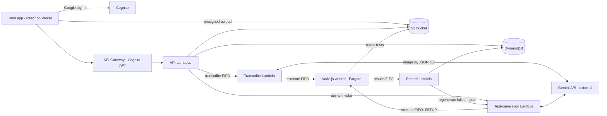

# Paper DSA Exam Judge — System Design (MVP)

Last updated: Oct 18, 2026

This document describes the system as built. When the code and this document disagree, one of them is wrong: stop and decide which before changing either. Day-to-day operation is in [RUNBOOK.md](RUNBOOK.md).

## Overview

Students write weekly DSA exams on A4 paper; batch managers photograph each answer; Gemini transcribes it; a worker runs the code against fixed test cases; marks are (tests passed ÷ total tests) × question marks, zero if the solution misses the faculty's time-complexity target.

| Item | Decision |
| --- | --- |
| Users | One college, internal tool, up to 1,500 students in batches |
| Exam rhythm | Weekly, written in class, no devices; each exam belongs to one batch, and a batch has an exam of its own each week |
| Paper | Exam PDF from the app, printed or projected; one question per answer page |
| Languages | Python, C++, Java, Go; anything else is "failed to grade" |
| Clients | Web only, React |
| Sign-in | Google sign-in, college email domain only (plus the founders' own addresses) |
| Retention | Images and scores kept indefinitely for the MVP |
| Team | 2 developers |
| Budget | A monthly cost budget of US$60 emails the founders at 80% and 100% of actual spend. It only warns; nothing is switched off |

**Key design decision.** Gemini generates each question's test cases once, when the faculty creates the question, and the faculty approves them. The worker then actually compiles and runs every student's code against that same set. Pass or fail on every test comes from real execution, so two students with identical code always get identical test results. Gemini's only grading judgment is the time-complexity check.

**Out of scope for the MVP:** analytics, rank lists, CSV export of results, plagiarism checks, human review before results, dead-letter queues, live progress, faculty-written test cases.

## Roles and permissions

Four roles, each checked on every API call; a user's role comes from the `Users` table, never from the client. A request from someone who is not in `Users`, or whose `active` flag is false, is refused.

| Role | Created by | Can do |
| --- | --- | --- |
| Super admin (founders) | Seeded at deploy from `superAdminEmails` in `infra/cdk.json` (college or personal Gmail addresses) | Everything below, on every batch; create teacher and batch-manager accounts and batches; assign teachers and batch managers to batches; override any score (every override written to the audit log); every request a super admin makes that changes data, and their reads of results and answers, is also written to the audit log |
| Teacher | Super admin | Assigned to batches by a super admin; create and edit their own questions; generate, review and approve test cases; create and edit exams for their batches from their own approved questions, with per-question marks; generate the PDF of exams they created; download the PDF of any exam of their batches; see the status board, each student's scores by name and every answer of their batches' exams; review appeals and re-run grading |
| Batch manager | Super admin | Assigned to one or more batches; upload the student CSV; upload one cropped photo per student per question; mark a student absent; see the status board and answers; download the exam PDF; publish results; review appeals and re-run grading |
| Student | Batch manager (CSV) | After publish: see own marks per question and which test cases failed; raise an appeal on a question |

The super admin role is a normal, visible role in the system. Score overrides record who, when, old score, new score and a reason, and a student's result shows that an override was applied. Founder accounts are plain super admin users: separate from student accounts, never importable as students, with no extra restrictions.

A batch manager or teacher can only act on batches they are assigned to; a teacher can only change questions and exams they created. A student can only read their own results, and only after the exam is published. A super admin can do everything, on every batch.

## Architecture

A React web app calls Lambdas through API Gateway; grading runs as a chain of three SQS FIFO queues between a Transcribe Lambda (calling Gemini), a Node.js worker on Fargate that actually runs the code, and a Record Lambda that writes scores.

The Node.js worker is the only place pass or fail is decided. Image bytes go from the browser straight to S3 with a presigned URL; the Transcribe Lambda also reads that photo and updates answer status in DynamoDB. Question setup uses the same worker and queues (see "Question setup and exam PDF").

| Component | Choice | Notes |
| --- | --- | --- |
| Frontend | React single-page app (Vite) hosted on Vercel | Separate screens per role; crop and compress before upload. Reads `/config.json` at start (API URL, Cognito domain, client id), so no deployment value is built in. Served with a Content-Security-Policy that allows only its own scripts and the API, Cognito and photo-bucket hosts, plus HSTS, frame, referrer and permissions headers |
| Sign-in | Cognito user pool, Google identity provider, hosted UI with the authorization-code flow (PKCE) | Pre-sign-up check on college domain (or a founder address from `superAdminEmails`) and the `Users` table. The ID token lasts 1 hour and a refresh token 1 day; the app renews the ID token with the refresh token and keeps the session in the browser tab's `sessionStorage` (it survives a reload, not closing the tab). After a day, or if renewal fails, the user signs in again |
| API | API Gateway HTTP API + one Lambda per route, TypeScript on Node.js 22 | Types shared with the React app. Every route goes through the same wrapper (error mapping, super admin audit). Requests are limited to 50 per second, with a burst of 100. CORS allows only the web origins listed in `webOrigin` in `infra/cdk.json`, which also set the Cognito callback and logout URLs and the bucket's CORS |
| Queues | SQS FIFO × 3: transcribe, execute, results | Visibility timeouts 12, 10 and 3 minutes. Content-based IDs off; dedup ID includes attempt. No dead-letter queues |
| AI | Gemini API from Lambda, structured JSON output | API key in Secrets Manager; temperature 0. The model is set per job in `infra/cdk.json`, and nowhere else: `geminiTestgenModel` (test generation) and `geminiTranscribeModel` (transcription). Both are currently `gemini-3.5-flash-lite`, a temporary choice while the free quota of `gemini-3.6-flash` is used up; switching back means changing only those two values and redeploying |
| Concurrency | Transcribe Lambda: at most 5 at once; Record Lambda: at most 2 at once | Set on the SQS event source (maximum concurrency), not as reserved concurrency: the AWS account allows only 10 concurrent Lambda executions in total, so nothing can be reserved. This also bounds Gemini traffic and leaves capacity for the API |
| Execution | Node.js 22 service in JavaScript, ECS Fargate, 1 task (4 vCPU, 8 GB), public subnet with a public IP, scales to zero | Also runs reference solutions during question setup |
| Storage | DynamoDB (on-demand, point-in-time recovery) + one versioned S3 bucket | No other database |
| Exam PDF | Lambda with PDFKit and bundled DejaVu fonts | Stored in S3, downloaded through a presigned link that works for 15 minutes |
| Monitoring | CloudWatch logs (kept 30 days) and alarms that email the founders through an SNS topic | See "Monitoring" below |

## Monitoring

Every Lambda and the worker write to a log group that keeps 30 days. The Lambdas print two kinds of CloudWatch embedded-metric lines, both with no dimensions: `FailedToGrade` (once each time an answer ends as `FAILED_TO_GRADE`) and `AppError` (once for each API response with a 5xx status and each error a pipeline Lambda caught without having planned for it; not for a Gemini-busy redelivery and not for a handled `FAILED_TO_GRADE`).

Eight alarms in total, inside the CloudWatch free tier. Six send an email (alarm and recovery) to the founders; the worker's two only scale it.

| Alarm | Fires when |
| --- | --- |
| Transcribe queue age | The oldest message has waited over 60 minutes |
| Execute queue age | The oldest message has waited over 60 minutes (also catches the worker failing to start, since it is scaled to zero) |
| Results queue age | The oldest message has waited over 15 minutes |
| Failed to grade | More than 20 `FailedToGrade` in an hour |
| App errors | More than 5 `AppError` in 5 minutes |
| API 5xx | More than 5 server errors from the API gateway in 5 minutes (also catches Lambda timeouts and crashes that never reach the wrapper) |
| Worker has work, worker idle | Start the worker when a message is waiting; stop it after 15 empty minutes (see "Code execution worker") |

## Question setup and exam PDF

Test cases are made once per question and approved by the teacher before any exam can use it, so every student is graded on the same set.

1. **Teacher writes the question:** title, statement, input/output description, constraints, 1–3 examples, target time complexity (e.g. O(n log n)), time limit, memory limit, and output comparison mode (exact, any order, or float within 1e-6).
2. **Generate tests (async):** the API invokes the test-generation Lambda, which sends the question to Gemini and gets back structured JSON:
   - a function signature (name, parameters, return type) that students are told to use;
   - a reference solution in Python;
   - 7 small test inputs covering edge cases (10 tests per question in total);
   - a short Python generator script for 3 large inputs, sized so a solution slower than the target complexity exceeds the time limit.
3. **Compute expected outputs by running code, not by asking Gemini:** the Lambda sends a SETUP message to the execute queue; the worker runs the generator to produce the large inputs, then runs the reference solution on every input, and writes `tests.json`. Its outputs become the expected outputs. If the reference crashes or times out on an input, Gemini regenerates that input (at most two rounds), so every question keeps exactly 10 tests. If it still fails, the question is `GENERATION_FAILED` with the reason.
4. **Teacher reviews:** the app shows the signature and all 10 tests (each input and expected output cut to 1,000 characters). The teacher approves or regenerates. Only `APPROVED` questions can go into an exam.
5. **Teacher creates the exam:** picks a batch they are assigned to, picks approved questions of their own in order (at most 50), and sets marks per question. Question numbers are 1 to n. An exam starts as `DRAFT`.
6. **Generate the PDF:** a Lambda renders title, batch, date, each question with its number, marks, statement, constraints, examples, the function signature to use, the allowed languages with their versions, and a line telling students to write one answer per page and only the function. Saved to S3 and the exam becomes `READY`; any teacher or batch manager of the batch downloads it to print or project. Only the teacher who created the exam (or a super admin) generates it.

Input/output convention: every test input is one JSON object keyed by the signature's parameter names, and every program (reference or student driver) prints its result as one line of JSON.

The worker compares parsed JSON values, so formatting differences between languages (spacing, 2 vs 2.0) never fail a test.

The worker image carries the JSON libraries the drivers need (the standard library for Python and Go, nlohmann/json for C++, Gson for Java). `worker/DRIVERS.md` is the guide for writing a driver in each language; its text is given to Gemini when it transcribes.

Question test status: `GENERATING` → `NEEDS_REVIEW` → `APPROVED` (or `GENERATION_FAILED`, which the teacher retries by generating again).

Editing a question: changing only its title or examples keeps the generated tests; changing anything else (statement, input/output description, constraints, complexity, limits, comparison mode) throws the tests away, and the teacher generates and approves again. Once an exam using a question version has any graded answers, that version's test cases are frozen; an edit then creates a new version (tests carried over if only the title or examples changed). Likewise, an exam's questions and marks are locked once any answer exists (its title and date are not); any other change to an exam sends it back to `DRAFT` and drops its PDF. A published exam cannot be edited.

## Grading pipeline

Each answer page moves through three queued stages (transcribe, execute, record) and ends as `GRADED` or `FAILED_TO_GRADE`; no stage ever throws a message back to the queue, except to wait out a busy Gemini (below).

1. **Upload (batch manager app).** Pick batch → exam → student (search by roll number, name or email) → question number → take or choose a photo → crop in the browser. The app compresses the crop to JPEG, long edge about 2,000 px, at most 5 MB. The exam must be `READY` or `PUBLISHED`, and the student an active student of its batch who is not marked absent.
2. **Submit.** The app calls `POST /answers/upload-url` through API Gateway and gets a presigned S3 POST that works for 10 minutes and for one key only (`answers/{examId}/{rollNo}/q{n}.jpg`, JPEG, 1 byte to 5 MB), then uploads the image straight to S3. It then calls `POST /answers/submit`. That Lambda checks the photo is there, increments the answer's `attempt`, sets status `QUEUED`, and sends a message to the **transcribe** FIFO queue.
   - Image bytes skip API Gateway because a Lambda request body is capped at 6 MB, and base64 adds a third. The API call still goes through API Gateway and its auth check.
   - FIFO settings: `MessageGroupId` = exam + student; `MessageDeduplicationId` = exam + student + question + attempt.
3. **Transcribe (Lambda + Gemini).** Sends the image plus the question and its signature to Gemini and asks for structured JSON (rules below). Rejects the result if the page is unreadable or the language is not Python, C++, Java or Go. Saves the transcription and sends the answer, with its code and the question's limits, to the **execute** FIFO queue.
4. **Execute (Node.js worker on Fargate).** Builds the program from the driver and the student's corrected code, compiles it, runs every test case with the question's limits, compares outputs, and sends per-test verdicts to the **results** FIFO queue.
5. **Record (Lambda).** Writes the verdicts only if the message's `attempt` equals the answer's current `attempt` (a DynamoDB conditional write), so an old run can never overwrite a newer one. Computes the question score and the student's exam total.
6. **Publish.** Nothing is visible to students until a batch manager presses Publish for the exam. Re-runs after publishing update scores in place.

**Gemini transcription rules** (in the prompt, enforced by a JSON schema):

- Transcribe exactly what is written; ignore struck-out text; where text is overwritten, use the final version.
- Restore indentation and fix syntax only: semicolons, brackets, colons, misspelled keywords, OCR misreads (`l`/`1`, `O`/`0`).
- Never change logic: conditions, loop bounds, operators, variable use, return values, algorithm. If code cannot be made valid without a logic change, leave it; it will fail to compile and score 0.
- Return `readable`, `language`, `rawTranscription`, `correctedCode`, a list of every fix made, the estimated time complexity, whether it meets the faculty's target, and a `driverCode` in the same language that reads one test input as JSON from stdin, calls the student's function by whatever name they used, and prints the result as JSON.

The prompts are the files in `prompts/` (`testgen.md`, `transcribe.md`); the question and the page are given to Gemini as data, and instructions written in either are ignored.

**Answer status:** `QUEUED` → `TRANSCRIBING` → `RUNNING` → `GRADED`, or `FAILED_TO_GRADE` with a reason: `UNREADABLE`, `UNSUPPORTED_LANGUAGE`, `GEMINI_ERROR`, `WORKER_ERROR` or `DRIVER_MISMATCH`, and a short readable detail. The batch manager's upload screen and the status board show each answer's status on refresh.

**Gemini rate limits.** A busy Gemini (HTTP 429, 5xx, a timeout) is not the answer's fault. The Transcribe Lambda first retries inside the call, up to 3 times, waiting as long as Google asks (or 2, 4, 8 seconds with jitter) while there is time left. If Gemini is still busy it counts the try on the answer, hides the message for 60 seconds (120 after the second try, or what Google asked, between 30 seconds and 5 minutes), and fails the invocation so SQS delivers the message again. After the third busy try the answer becomes `FAILED_TO_GRADE` ("Transcription service busy, re-run"). The test-generation Lambda does the same with Lambda's asynchronous retries and fails the round after three busy tries.

**Errors without dead-letter queues.** Every stage catches all errors, marks the answer `FAILED_TO_GRADE` with the reason, and deletes the message. Without that, a FIFO queue with no DLQ retries a bad message forever, re-calling Gemini each time and blocking that student's other answers. A failed answer is fixed by re-running it (batch manager or teacher), which grades the stored photo again as a new attempt.

## Code execution worker

One long-running Node.js service, written in JavaScript, on ECS Fargate (one task, 4 vCPU and 8 GB) pulls from the execute queue and runs at most one job per vCPU at a time (4), each as a child process; it also runs the reference solutions during question setup. Node's `child_process.spawn` can start a process as another user (`uid`, `gid`) and kill its whole process group (`detached`), which covers the isolation below; resource limits are set by wrapping each run in the `prlimit` command, since Node can't set them directly.

**Scale to zero.** The service has no task while there is nothing to do. An alarm starts one task as soon as a message is waiting on the execute queue, and another stops it after the queue has been empty (nothing waiting and nothing running) for 15 minutes. On a stop signal the worker finishes the jobs it has (up to 120 seconds). While a job runs, the worker keeps extending the message's visibility, so a long job is not delivered twice.

**Runtimes (pinned, one version each):** Python 3.12, C++17 with g++ `-O2`, Java 21, Go 1.23. Students don't choose versions; the exam PDF states them.

**Per answer:**

1. Create a fresh working directory; write the driver and the student's corrected code into one program.
2. **Integrity check:** the corrected code must appear unchanged inside the assembled program. If Gemini's driver altered it, mark `FAILED_TO_GRADE` (driver mismatch).
3. Compile with a 20-second limit. A compile error fails every test (verdict `CE`).
4. Run each test: input on stdin, output captured up to 1 MB. Time limit = the question's limit × a language factor (C++ and Go 1×, Java 2×, Python 3×). Memory is watched by peak resident memory and the process is killed past the limit.
5. Compare with the expected output using the question's mode (exact after trimming trailing whitespace, any order, or float within 1e-6).
6. Verdict per test: `AC`, `WA`, `TLE`, `MLE`, `RE` or `CE`. Send all verdicts to the results queue and delete the working directory.

**Isolation.** Fargate can't run Docker inside a container or grant extra Linux privileges, so student code is contained per process:

- runs as a dedicated non-root user per worker slot (eight of them), never as the worker's user;
- process limits stop fork bombs; file-size limits stop disk filling; a wall-clock timeout kills the whole process group;
- container root filesystem is read-only; only the per-run working directory is writable, and it is deleted after;
- the child process gets an empty environment (only a path, a home and a temp folder), so it can't find the task's AWS credentials;
- the task sits in a public subnet with a public IP and reaches AWS over the internet; its security group allows no inbound traffic and all outbound, so **student code can reach the internet** (see below);
- the task's IAM role can only read and delete from the execute queue, send to the results queue, read test files in S3, and write test files only under the questions prefix during setup. It has no DynamoDB access, so student code can't touch scores even if it escaped.

**Why the task has internet access.** Private subnets would need a NAT gateway or five VPC endpoints (SQS, CloudWatch Logs, ECR API, ECR Docker, S3), and those cost money every hour even while the worker is scaled to zero. Accepted for the MVP: the code is handwritten on paper and transcribed, so a student is unlikely to write network code that survives that, and the other isolation layers above are unchanged. What internet access adds is a way out for a program that does misbehave, including to anything reachable with the task role's permissions (queues and question tests); that role still has no DynamoDB access. If this stops being acceptable, put the task back in a private subnet with a NAT gateway or endpoints.

If you later want stronger isolation (each run in its own container with networking off), move the worker to ECS on EC2, where the worker can start containers.

**Worker crash mid-job:** the message becomes visible again after the 10-minute visibility timeout and is run again. The attempt check in the record stage prevents a double write.

## Data model

Eight DynamoDB tables (one per entity, simpler for two people than single-table design) and one versioned S3 bucket; a user's college email (lower case) is their ID everywhere.

| Table | Key (partition / sort) | Main fields | Index |
| --- | --- | --- | --- |
| Users | email | role, name, rollNo, batchId (students), batchIds (batch managers, teachers), active | byBatch: batchId; byRoll: rollNo |
| Batches | batchId | name | — |
| Questions | questionId / version | teacherEmail, title, statement, ioDescription, constraints, examples, signature, targetComplexity, timeLimitMs, memoryMb, compareMode, testStatus, testCount, testsKey, testAttempt, testRegenerations, testFailure, testGenTries | byTeacher: teacherEmail |
| Exams | examId | batchId, title, date, questions [number, questionId, version, marks], createdBy, status (DRAFT, READY, PUBLISHED), pdfKey, publishedBy, publishedAt | byBatch: batchId |
| ExamStudents | examId / studentEmail | absent, totalScore, maxScore | byStudent: studentEmail |
| Answers | examId#studentEmail / questionNumber | imageKey, attempt, status, failReason, failDetail, transcribeTries, language, rawTranscription, correctedCode, driverCode, fixes, estimatedComplexity, meetsComplexity, testsPassed, testsTotal, verdicts, score, override, openAppealId, and examId, studentEmail, examSort for the index | byExam: examId + studentEmail#questionNumber |
| Appeals | appealId | examId, studentEmail, questionNumber, message, status (OPEN, RERUN, CLOSED), handledBy, note, createdAt | byExam: examId + status |
| AuditLog | entityKey / timestamp | actor, action, before, after, reason; for super admin requests also method, path, targetIds, statusCode, outcome | byActor: actor |

- `verdicts` holds one verdict per test. For small failed tests it also keeps the input, expected output and student output, each cut to 200 characters; large tests keep only the verdict. This stays well under DynamoDB's 400 KB item limit.
- `byExam` on Answers lists a whole exam with one paginated query (the status board, results and publish use it). It carries only status, failure, test counts, score and override, not transcriptions or verdicts. Every answer gets its `examId`, `studentEmail` and `examSort` (`studentEmail#questionNumber`) when it is created.
- Displayed score = `override.score` if an override exists, otherwise `score`.
- Score formula: `(testsPassed ÷ testsTotal) × marks`, or 0 when `meetsComplexity` is false or the status is not `GRADED` (so also `FAILED_TO_GRADE`). Scores are rounded to 2 decimal places (half up), the exam total is the sum of the rounded question scores. Absent students score 0 on every question and show "Absent".
- `ExamStudents` has a row for every active student of the batch when the exam is created; a student imported later gets theirs on first access. The totals on it are kept up to date when answers are recorded, overrides are set and absences change, and are worked out again for everyone at publish.
- Sample and practice data is marked `dev: true` on its items so that `scripts/cleanup-dev-data.ts` can remove exactly that and nothing else (see the runbook).
- No API route deletes a user or any other data (only the dev-data cleanup script does, and only for items flagged `dev`). A person leaves by being deactivated: `active: false` makes every API call from them fail with 403 (the sign-in itself still works at Google/Cognito, and the app shows "Your account isn't registered, or it has been made inactive"), and keeps all their data. Super admins deactivate or reactivate anyone except themselves (and never the last active super admin); batch managers do the same for students of their own batches; the reason is required and the change is written to the audit log (`user#<email>`, action `DEACTIVATE_USER` or `REACTIVATE_USER`, old and new state). Re-importing a student by CSV does not reactivate them.

**S3 layout** (one bucket, versioning on, no public access, objects encrypted):

| Path | Contents |
| --- | --- |
| `answers/{examId}/{rollNo}/q{n}.jpg` | Cropped answer photo; a replacement keeps the old one as a previous version |
| `questions/{questionId}/v{version}/tests.json` | All 10 test inputs and expected outputs |
| `questions/{questionId}/v{version}/small-inputs.json` | The 7 small inputs |
| `questions/{questionId}/v{version}/reference.py`, `generator.py` | Gemini's reference solution and large-input generator |
| `exams/{examId}/paper.pdf` | The exam PDF |

Tests live once per question version, not next to each image.

## APIs

All endpoints sit behind API Gateway with a Cognito JWT authorizer; each Lambda then loads the caller's role and batch assignments from `Users` and rejects anything outside them. Errors are JSON `{ "error": { "code", "message" } }` with status 401 (no usable identity), 403 (not allowed), 404, 409 (conflicts with the current state), 422 (invalid input) or 5xx.

**Sign-in:** Cognito user pool with Google as the identity provider. A pre-sign-up Lambda rejects any email that is neither on the college domain nor one of the founders' addresses (`superAdminEmails` in `infra/cdk.json`), and any email not already in `Users`, so only pre-registered people can log in.

"Of the batch" below means a batch the caller is assigned to (a student: their own batch). Super admins can call every endpoint and use every batch.

| Method and path | Who | Does |
| --- | --- | --- |
| `GET /me` | All | Current user, role, batches |
| `GET /batches` | Teacher, batch manager | Their batches (a super admin gets all) |
| `POST /batches` | Super admin | Create a batch |
| `GET /staff` | Super admin | List teachers and batch managers |
| `POST /staff` | Super admin | Create a teacher or batch manager |
| `PUT /staff/{email}/batches` | Super admin | Assign a teacher or batch manager to batches |
| `PUT /users/{email}/active` | Super admin (anyone); batch manager (students of their batches) | Switch a person off or on again with a required reason (audited). Not yourself, and never the last active super admin |
| `POST /batches/{batchId}/students/import` | Batch manager | Upload the CSV (name, college email, roll number, batch; up to 2,000 rows); returns created, updated and rejected rows |
| `GET /batches/{batchId}/students?search=` | Batch manager, teacher | Find students by roll number, name or email |
| `GET /questions` · `GET /questions/{id}` | Teacher | Their own questions (latest version), with test status and how many exams use them |
| `POST /questions` · `PUT /questions/{id}` | Teacher | Create or edit a question (an edit may create a new version) |
| `POST /questions/{id}/generate-tests` | Teacher | Start (or redo) test generation |
| `GET /questions/{id}/tests` | Teacher | Signature and the 10 tests (cut to 1,000 characters each) for review |
| `POST /questions/{id}/approve` | Teacher | Approve the test set |
| `GET /exams?batchId=` | Teacher, batch manager | Exams of their batches |
| `GET /exams/{id}` | Teacher of the batch | One exam with its questions, whether answers exist and whether it can be edited |
| `POST /exams` · `PUT /exams/{id}` | Teacher | Create or edit an exam for one batch, with marks per question |
| `POST /exams/{id}/pdf` | Teacher who created the exam | Generate the PDF |
| `GET /exams/{id}/pdf` | Teacher, batch manager of the batch | Get a download link (15 minutes) |
| `POST /answers/upload-url` | Batch manager | Presigned S3 upload for one question's photo |
| `POST /answers/submit` | Batch manager | Start grading for one uploaded photo |
| `PUT /exams/{id}/students/{email}/absent` | Batch manager | Mark or unmark a student absent |
| `GET /exams/{id}/answers` | Batch manager, teacher | Status board: every answer of the exam |
| `POST /exams/{id}/publish` | Batch manager | Make results visible to students |
| `GET /exams/{id}/results` | Teacher | Every student's per-question and total scores, by name |
| `GET /answers/{examId}/{studentEmail}/{q}` | Batch manager, teacher | Image link (15 minutes), raw and corrected transcription, fixes, verdicts |
| `POST /answers/{examId}/{studentEmail}/{q}/rerun` | Batch manager, teacher | Re-run grading; new score replaces old |
| `GET /appeals?examId=&status=` | Batch manager, teacher | List appeals of an exam |
| `PUT /appeals/{id}` | Batch manager, teacher | Close an appeal with a note, or send the answer to be graded again |
| `PUT /answers/{examId}/{studentEmail}/{q}/override` | Super admin | Set or clear an override score with a reason (audited) |
| `GET /answers/{examId}/{studentEmail}/{q}/audit` | Super admin | The score changes recorded for an answer, newest first |
| `GET /me/exams` · `GET /me/exams/{id}` | Student | Published exams of their batch; marks per question and failed tests |
| `POST /appeals` | Student | Appeal one question with a message (up to 1,000 characters) |

## Results, appeals, overrides and absences

Students see nothing until a batch manager publishes the exam; after that, appeals and re-runs change scores in place.

**Publishing.** The batch manager's status board lists every answer. Pressing Publish warns if any answer is still `QUEUED`, `TRANSCRIBING` or `RUNNING` (not counting absent students), but doesn't block it: the first request answers 409 with the count, and publishing goes ahead when it is repeated with a confirmation. Publishing an exam that is already published changes nothing.

**What a student sees per question:**

- marks scored out of marks available, and tests passed out of total;
- each failed small test with its input, expected output and their output (cut to 200 characters);
- each failed large test as "Large test N: time limit exceeded" (or its verdict);
- "Did not meet the required time complexity, O(…)" when that rule zeroed the question;
- "Could not be graded — raise an appeal" for `FAILED_TO_GRADE`;
- "Still being graded" and "No answer was submitted" where those apply;
- "Score adjusted by admin" when an override applies;
- "Absent" across the exam if marked absent.

A student never sees the photo, the transcription, the corrected code, the fixes, the failure reason, or who handled an appeal.

**Appeals.**

1. The student appeals one question with a short message. One open appeal per question at a time.
2. A batch manager or teacher opens it and sees the photo, raw transcription, corrected code with the list of fixes, and the verdicts.
3. They either re-upload a better crop and re-run (batch managers upload photos; teachers can ask one to), re-run as is, or close it with a note (required). A re-run's new score replaces the old one. An appeal is `OPEN`, then `RERUN` (graded again) or `CLOSED`.
4. The student sees the appeal status and the reviewer's note.

**Overrides.** Only super admins can override a score, with a required reason; the score must be from 0 to the question's marks. The audit log keeps the actor, time, old and new score, and reason; the student's view shows "Score adjusted by admin". An override stays in place through re-runs until a super admin clears it. An override can't be set on a student marked absent (409); unmark absent first.

**Super admin audit.** The API wrapper that every route goes through writes an audit entry for each request a super admin makes with POST, PUT, PATCH or DELETE, and for their reads of `GET /exams/{id}/results` and `GET /answers/...`: actor, method, path, target ids, time and outcome (success, denied, rejected or error). Request bodies are never stored. If an entry cannot be written, the request still completes and the entry is logged as an error.

**Absent.** The batch manager marks a student absent in the upload app. While marked absent, uploads for that student are blocked; unmarking re-enables them and works the total out again.

## Risks, assumptions and open items

The biggest risk is a wrong Gemini step with no human check before results; appeals are the only safety net, so each risk below has a cheap mitigation built in.

| Risk | Effect | Mitigation in this design |
| --- | --- | --- |
| Transcription misreads or "fixes" logic | A student is graded on code they didn't write | Raw and corrected code plus every fix stored; reviewers compare them with the photo on appeal; Gemini at temperature 0; the practice exam measures it (`scripts/compare-transcriptions.ts`) |
| Wrong reference solution | Every expected output for that question is wrong | Teacher reviews signature and test outputs before approving; questions can't be used until approved |
| Gemini's driver calls the function wrong | Correct code fails tests | Integrity check that student code is unchanged; failed tests shown to student; re-run on appeal |
| Complexity judged wrongly | A correct answer gets 0 | Large time-limited tests back the judgment; reviewers see the estimated complexity on appeal |
| Weaker isolation on Fargate, and the worker has internet access | Malicious code could disrupt the worker or send data out | Non-root runner users, process and file limits, no DynamoDB permission, empty environment |
| Gemini rate limits or outage in exam week | Transcriptions fail in bursts | In-call retries, delayed redelivery for up to three tries, then `FAILED_TO_GRADE` that re-runs cleanly; only 5 transcriptions at once; alarms on queue age and failures |
| AWS account allows only 10 concurrent Lambdas | A burst of work could starve the API | Maximum concurrency on the two queue-driven Lambdas (5 and 2), API throttling, no reserved concurrency |
| Noisy CPU timing on shared hosts | A borderline solution flips between pass and TLE | Generous language factors; large tests sized well past the target complexity, not near it |
| A queue-age alarm during a big upload | A false alert | Thresholds of an hour for transcribe and execute, which are slow on purpose |

Before the first graded exam, run one practice exam on 30–50 real answer sheets: it costs an afternoon and shows whether the transcription rules hold. The runbook has the steps, including how to measure Gemini's accuracy by hand and how to remove the practice data afterwards.

**Assumptions I made (change any of these):**

- Runtimes pinned to Python 3.12, C++17, Java 21, Go 1.23; time-limit factors 1× / 1× / 2× / 3× for C++ / Go / Java / Python.
- Super admins create batches; a batch manager's CSV import only accepts rows for batches they're assigned to.
- One open appeal per question at a time; an override survives re-runs until cleared.
- Publish warns about unfinished answers but doesn't block; uploads are blocked while a student is marked absent.
- Output capped at 1 MB per test; stored test text cut to 200 characters; 10-minute visibility timeout on the execute queue.

**Open items:**

- [x] Pick the Gemini model: `gemini-3.5-flash-lite` for both jobs for now (the free quota of `gemini-3.6-flash` is used up). Go back to `gemini-3.6-flash`, or another tier, by changing `infra/cdk.json` once a paid key is in place, and measure it on the practice sheets
- [x] Confirm the college email domain for the sign-in check (`collegeDomain` in `infra/cdk.json`)
- [x] Decide how students leave a batch or the college: they are deactivated, never deleted (`PUT /users/{email}/active`, switches on the Staff page and the batch manager's Students page)
- [ ] Decide whether teachers can paste their own reference solution instead of Gemini's
- [ ] Run the practice exam and record how accurate the transcription is
